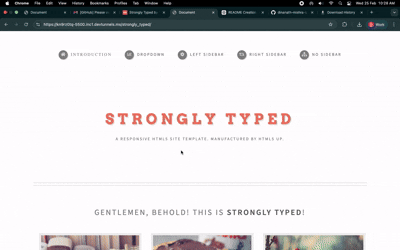

# 🚀 Strongly Typed – Responsive Website Template

A fully responsive multi-section website template built using HTML5, CSS3, and JavaScript.

This project is a recreation of the "Strongly Typed" template for learning and frontend development practice.

---

## 🔗 Repository

https://github.com/dinanath-mishra-iphtech/stronglyTyped.git

---

## 📌 Features

- Fully Responsive Layout
- Clean and Modern UI
- Multi-section Homepage
- Blog Section Layout
- Contact Form UI
- Reusable CSS Components
- Organized Folder Structure
- Mobile Friendly Design

---

## 🛠️ Tech Stack

- HTML5  
- CSS3   
- Google Fonts  
- Media Queries (Responsive Design)

---

## 📂 Project Structure

stronglyTyped/
│
├── assets/        # CSS and supporting files
├── images/        # Image resources
├── index.html     # Main HTML file
└── README.md

---

## 💻 How to Run Locally

1. Clone the repository:

git clone https://github.com/dinanath-mishra-iphtech/stronglyTyped.git

2. Open the project folder:

cd stronglyTyped

3. Open `index.html` in your browser.

---

## 📱 Responsive Design

This website works smoothly on:

- Desktop
- Tablet
- Mobile Devices

---

## 🎯 Purpose of This Project

This project was created to:

- Practice HTML & CSS layouts
- Improve responsive design skills
- Understand real-world template structure
- Strengthen frontend development fundamentals

---

## 🚀 Future Improvements

- Add backend functionality to contact form
- Improve animations and transitions
- Optimize performance
- Convert to React version

---

## 👨‍💻 Author

Dinanath Mishra  
GitHub: https://github.com/dinanath-mishra-iphtech  

---

## 📄 License

This project is created for educational and practice purposes.

## 🎥 Project Preview

